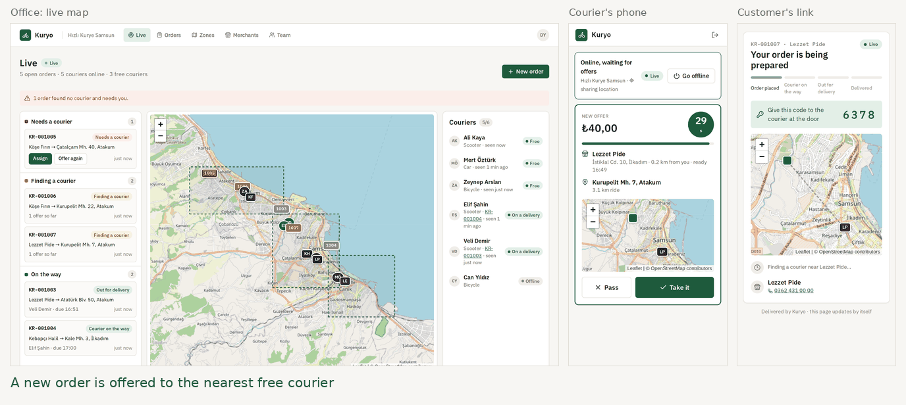
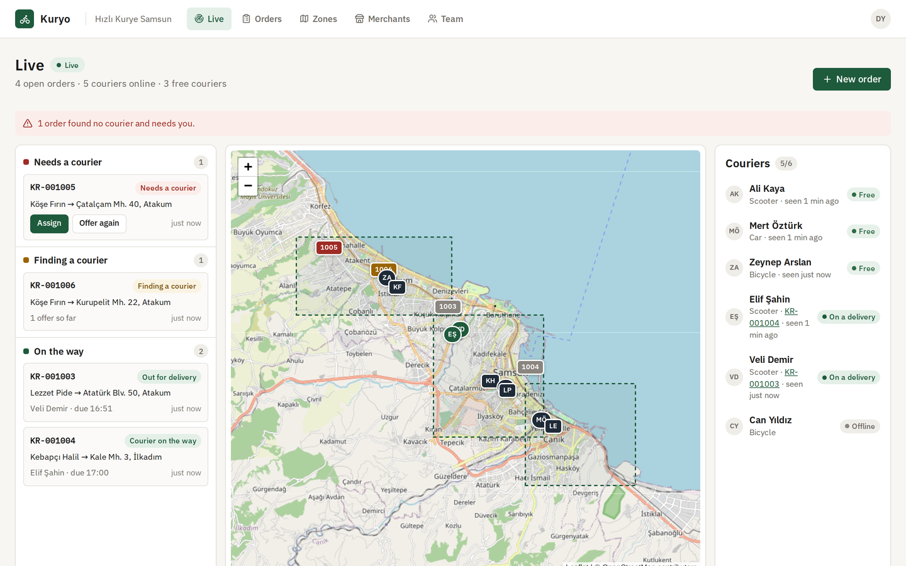
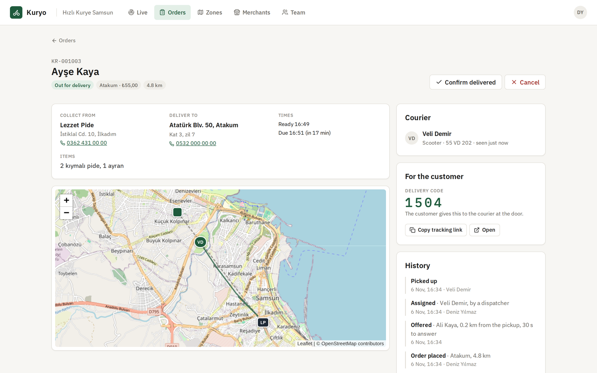
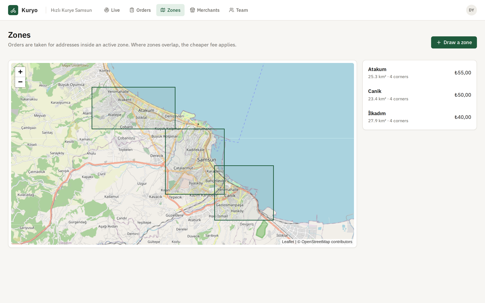
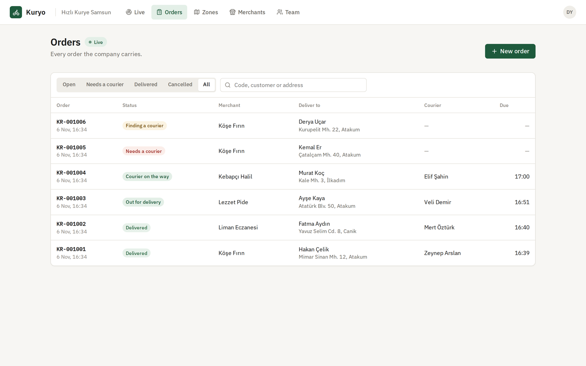
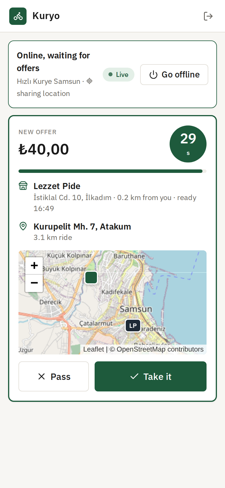
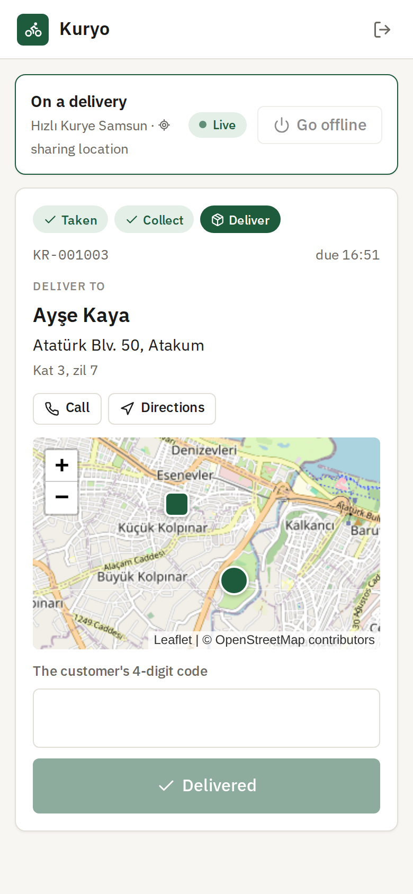
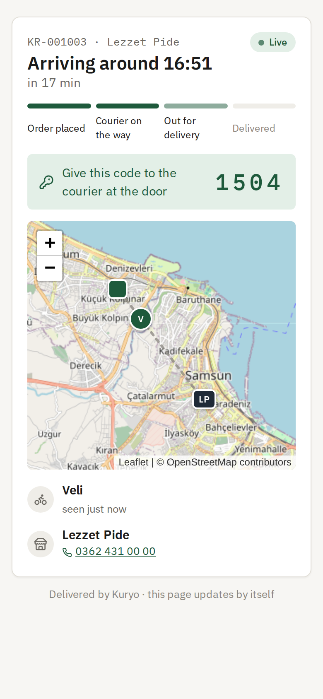
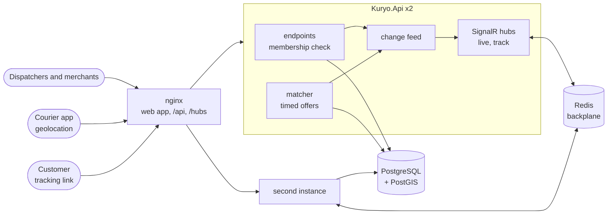
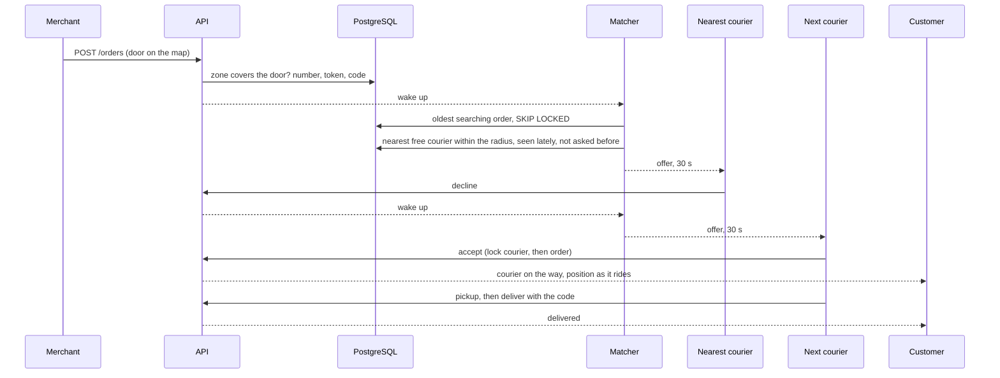

# Kuryo

**English** · [Türkçe](README.tr.md)

Courier dispatch for companies that deliver for restaurants, bakeries and pharmacies around town. A merchant sends an order with the customer's door picked on a map. The order is offered to the nearest free courier for a few seconds. If they pass or let the time run out, it goes to the next nearest, until someone takes it. When nobody does, it lands with a dispatcher, who can assign it by hand. The office follows every courier on a live map. Couriers work from a phone app that shares their position while they are online. Customers follow their delivery from a link, with no account, and give the courier a four-digit code at the door.

[](https://github.com/Beratoguzhan620/kuryo/actions/workflows/ci.yml)




## Try it

```bash
docker compose up --build
```

This starts PostgreSQL with PostGIS, Redis, two instances of the API and nginx with the web app. Open http://localhost:8080, create an account and a company. Draw a delivery zone on the map under *Zones*, then add a merchant under *Merchants*. Under *Team*, add a second account as a courier. Sign in as the courier at http://localhost:8080/courier in a phone-sized window, allow location and go online. Back in the office, send an order from *Live*. The offer appears on the courier's screen with a countdown.

- API reference: http://localhost:8080/scalar
- Tracking links look like http://localhost:8080/t/{token}; each order's page has a button to copy its link.

## Features

- **Companies and their teams:** couriers deliver; merchant staff send and follow the orders of their own shop; dispatchers run the live map and keep zones and merchants; owners also manage the team and how offers work. Membership and role are read from the database on every request. Orders a member may not see answer as if they did not exist.
- **Delivery zones:** areas drawn corner by corner on the map, stored as PostGIS polygons, each with its own fee. An order is taken only when its door falls inside an active zone; where zones overlap, the cheaper fee applies.
- **Merchants:** a pickup point, a phone and a usual preparation time, which every estimate waits for. A paused merchant cannot send orders.
- **Orders:** numbered per company (KR-001001), with the door as a point on the map and the address for the courier to read. Each order comes with a tracking token and a delivery code, and keeps a full history of who did what.
- **Timed offers:** each order goes to the nearest free courier who was seen in the last two minutes within the company's radius, for a set number of seconds. A courier who passes or does not answer is not asked about that order again. After the set number of offers, or once a search has lasted as long as those offers would take, the order waits for a dispatcher.
- **Dispatchers stay in charge:** assign by hand to a courier picked by distance, take an order back, send offers again, close a delivery without the code after a phone call, or cancel. An offer still out is taken back the moment a dispatcher acts.
- **Courier app (PWA):** go online, share position in batches, see an offer with a countdown, take it or pass, collect, and finish with the customer's code. Five wrong codes lock the delivery until the office closes it.
- **Live everywhere:** office screens, merchants and courier phones are updated over SignalR as orders move and couriers ride. With several API instances, Redis carries the messages between them.
- **Tracking link:** no sign-in. It shows the status, the estimate, the courier's first name and position while on the way, and the code to give at the door. It never shows the customer's name, phone or address, and it ends a day after delivery.
- **Estimates:** distance to the pickup and the trip as a straight line times 1.35 for city streets, at 14 km/h by bicycle, 24 by scooter and 20 by car; the courier leaves the pickup no earlier than the order is ready.

## Screenshots

| Live map | Order |
|---|---|
|  |  |
|  |  |

| An offer on the phone | Delivering | The customer's link |
|---|---|---|
|  |  |  |

## Measured

`tests/load/load.mjs` runs a busy evening against the full Compose stack (two API instances) on a standard GitHub Actions runner (4 cores), with the load client on the same machine. 300 couriers go online, ride around town and report their position every two seconds, and check for offers. 200 orders arrive over a minute. Every simulated courier answers its offers (one in five passes), collects and delivers with the code.

| Step | Result |
|---|---|
| Throughput | 21,371 requests in 68 s, 314 a second, no errors |
| Position reports (9,902) | p50 9 ms, p95 40 ms, p99 108 ms |
| Offer checks (9,502) | p50 4 ms, p95 15 ms |
| New order | p50 20 ms, p95 74 ms |
| From order to the first offer | p50 9 ms, p95 35 ms, max 380 ms |
| From order to a courier who took it | p50 1.3 s, p95 3.3 s (couriers check every 2 s) |
| Offers per order | p50 1, max 4; 47 passes |
| Outcome | 200 of 200 delivered |
| The books afterwards | 247 offers: 200 accepted, 47 declined, none pending; no order accepted twice |

What the numbers say:

- The first offer goes out in milliseconds because a new order wakes the matcher instead of waiting for its next tick; the rest of the wait is the courier reading the offer.
- Both API instances run the matcher at once. Orders and couriers are claimed with `FOR UPDATE SKIP LOCKED`, so neither instance waits for the other and no order is offered twice.
- Each instance used under 150 MB of memory. Numbers vary between runs on shared runners.

## Tech stack

- ASP.NET Core 10: minimal APIs, SignalR, a background matcher, ProblemDetails, OpenAPI with Scalar, JWT bearer, rate limiting
- PostgreSQL 17 with PostGIS: geography points and polygons, GiST indexes, nearest-first `<->` ordering, `ST_DWithin`, `FOR UPDATE SKIP LOCKED`, partial unique indexes, advisory locks, `xmin` as a concurrency token; Entity Framework Core 10 with Npgsql and NetTopologySuite
- Redis as the SignalR backplane
- React 18, TypeScript and Vite; @microsoft/signalr; the Geolocation API and a service worker; Leaflet with OpenStreetMap tiles; Lucide icons and IBM Plex; nginx
- xUnit, Testcontainers (PostGIS), the SignalR client in tests, Vitest, Playwright with geolocation
- GitHub Actions: warnings as errors, .NET and web tests, pending-migration check, browser walkthrough against the Compose stack
- Docker / Docker Compose

## Architecture



One order, from the merchant to the door:



## Design decisions

- **Matching in the database, nearest first.** The matcher picks the oldest order nobody is working on, then asks PostGIS for the closest courier who is free, was seen in the last two minutes, is within the radius, has no other offer open and has not been asked about this order before. The GiST index answers the `<->` ordering, so finding the nearest of hundreds of couriers is one indexed query.
- **Several matchers, no double offers.** Orders and couriers are claimed with `FOR UPDATE SKIP LOCKED`: an instance skips what another is handling instead of waiting. Two partial unique indexes (one pending offer per order, one per courier) make a double offer impossible even if the code were wrong; the matcher checks again after taking its locks, so in practice the indexes never have to say no.
- **Time is decided once.** An offer's deadline is fixed when it is made. Accepting after it fails even before the matcher has marked the offer expired, and the matcher expires offers with one conditional `UPDATE … RETURNING`. When an answer and an expiry race, the `xmin` check lets only one of them through.
- **Locks in one order.** Every path that touches a courier and an order locks the courier first, then the order, then the offer, so a dispatcher assigning by hand and a courier accepting at the same moment cannot deadlock.
- **Live updates from what was committed.** A save interceptor notes which orders, couriers and offers each request changed. Only after the request has succeeded does the publisher read their current state back and send it to the right groups: the office, the merchant, the courier, the customer's link. A client never sees something that was rolled back, and every message carries the full state, so nothing has to be merged.
- **No gap after connecting.** A screen loads its data and joins the live feed at the same time; once joined, it loads once more, so a change between the two is never missed. After a reconnect it does the same.
- **Positions in batches, with a heartbeat.** The phone keeps a point at most every three seconds and sends a batch every five, up to fifty points after a dead spot. Phone clocks are kept between ten minutes ago and now, and an older point never moves the courier back. A courier standing still sends their last position again every thirty seconds so they stay eligible for offers.
- **A link that gives away nothing.** The tracking token is 144 random bits. The page shows only what the customer already knows, sends `no-store` and `no-referrer`, and request logs print the path without the token. The courier never sees the delivery code: they have to ask for it at the door.
- **Straight lines, honestly.** Distances are great-circle kilometres and times use a detour factor of 1.35 and an average speed per vehicle. A routing service could replace that behind one function.
- **Instances that take turns.** Compose runs two API instances. They migrate behind a PostgreSQL advisory lock, share SignalR through Redis, and nginx keeps each browser on the instance it negotiated with.

## Commands

| Command | What it does |
|---|---|
| `docker compose up --build` | The whole app on http://localhost:8080 |
| `dotnet test` | .NET unit and integration tests (Docker needed for Testcontainers) |
| `cd web && npm install && npm test` | Web app unit tests |
| `cd web && npm run dev` | The web app with hot reload on http://localhost:5173, against the API on port 5800 |
| `cd tests/e2e && npm install && node kuryo.mjs` | The browser walkthrough, against a stack started with `AUTH_ATTEMPTS_PER_MINUTE=1000` |
| `cd tests/e2e && node media.mjs` | A demo company and the README screenshots |
| `node tests/load/load.mjs 300 200 60` | The load test, against a stack started with `AUTH_ATTEMPTS_PER_MINUTE=100000` |
| `dotnet ef migrations add <Name> --project src/Kuryo.Infrastructure --startup-project src/Kuryo.Api --output-dir Persistence/Migrations` | Add a migration |

Configuration for a local run, kept out of the repository (Redis is optional; without it, live updates stay within one instance):

```bash
dotnet user-secrets --project src/Kuryo.Api set "ConnectionStrings:Kuryo" "Host=localhost;Database=kuryo;Username=…;Password=…"
dotnet user-secrets --project src/Kuryo.Api set "ConnectionStrings:Redis" "localhost:6379"
dotnet user-secrets --project src/Kuryo.Api set "Jwt:SigningKey" "<at least 32 characters>"
```

## Tests

112 tests and a run against the whole stack: 56 .NET unit tests, 47 integration tests that run the real API against PostgreSQL with PostGIS in Testcontainers, 9 Vitest tests for the web app, and a 17-step Playwright walkthrough with five browsers, all in CI.

- **Teams and places:** roles from courier to owner, merchant staff tied to their shop, a courier carrying an order kept on the team, owners alone changing how offers work, outsiders unable to tell a company exists, and zones drawn, refused when their edges cross, and overlapping at the cheaper fee.
- **Orders:** numbers without gaps under twelve requests at once, addresses outside every zone refused, merchants seeing only their own orders, one courier given two orders at once getting one, assignment, hand-back, pickup, delivery with the code, wrong codes counted and locked after five, and cancellations freeing the courier.
- **Matching:** the nearest free courier asked first, a pass going to the next and never back, offers running out and moving on, an expired offer refused, the search ending after the set number of offers or the time they would take, couriers too far or out of touch skipped, offers taken back on manual assignment, cancellation and going offline, and three matchers running at once without a double offer.
- **Positions:** shared only online, at most fifty a request, phone times clamped, an older point never moving a courier back, and an order's trail.
- **Live:** dispatchers hearing orders and couriers move, a courier hearing their offer arrive and go, merchants hearing only their shop, outsiders and missing tokens refused, the tracking link without the customer's details, the customer's view following the courier, and the link ending a day after delivery.
- **Web app (Vitest):** the position queue's spacing, limit and retry, distances, countdowns, freshness and routes.
- **Browsers (CI):** an owner drawing a zone, adding a merchant and the team; two couriers going online with real geolocation; a cashier sending an order from the map; the nearest courier passing and the next taking it; the office and the customer following live; a wrong code refused and the right one closing the delivery; an order nobody answers assigned by hand; and no script errors.

## Roadmap and known gaps

- Real routes and times from a routing service (OSRM, Valhalla) instead of straight lines.
- Batching: offering a courier two orders from the same merchant at once.
- Notifications to the customer (SMS with the tracking link and code) through the [notification-service](https://github.com/Beratoguzhan620/notification-service).
- Courier earnings and end-of-day reports per company.
- Positions are kept indefinitely; a retention job would trim them after a few weeks.
- Membership changes do not drop a live connection; a removed member stops hearing updates at their next reconnect.

## License

[MIT](LICENSE) · Berat Oğuzhan Turğut · [GitHub](https://github.com/Beratoguzhan620)
