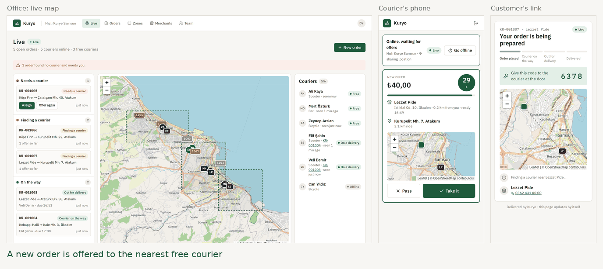
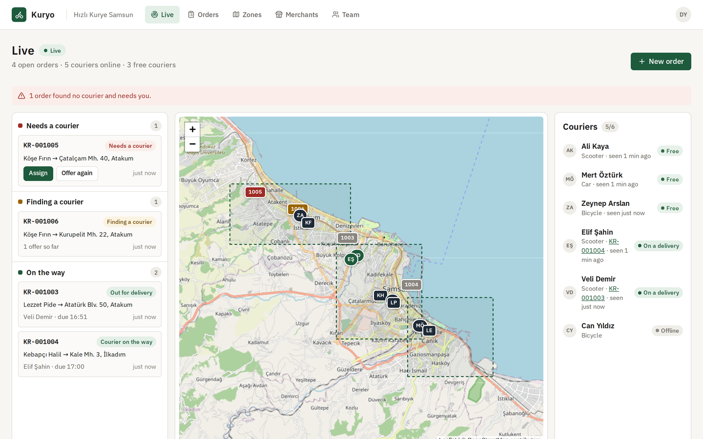
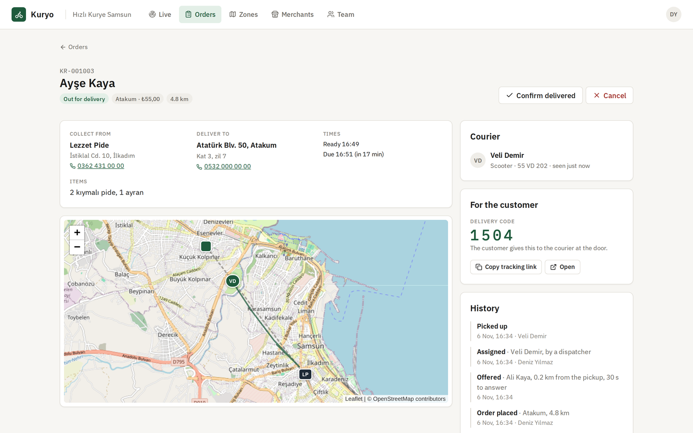
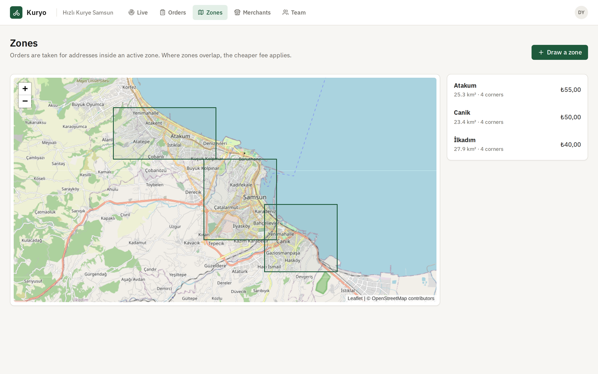
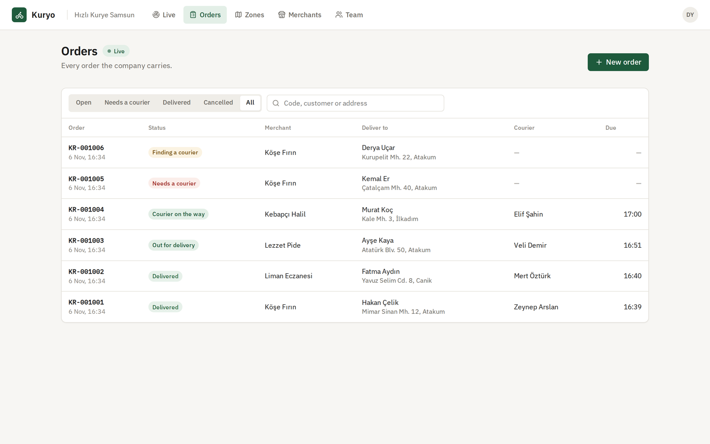
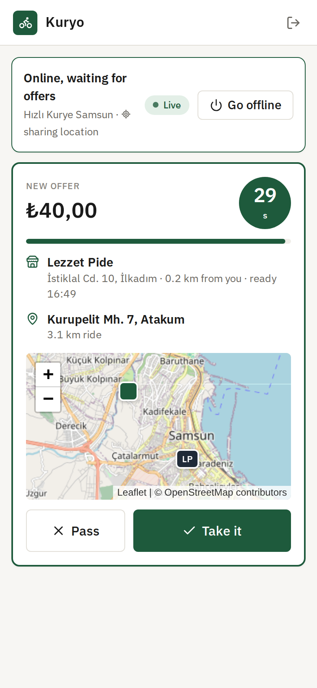
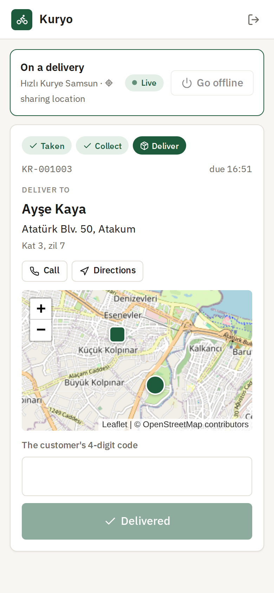
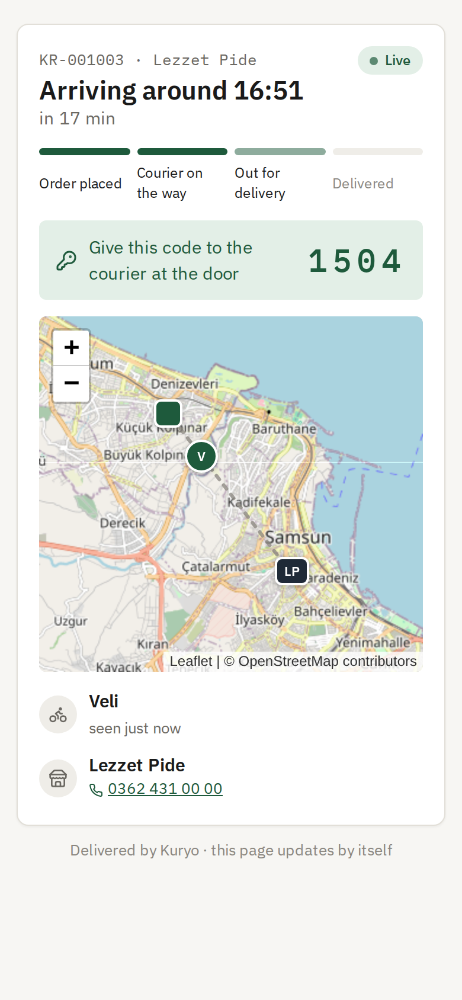
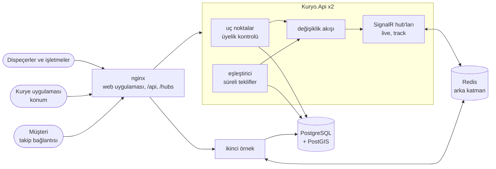
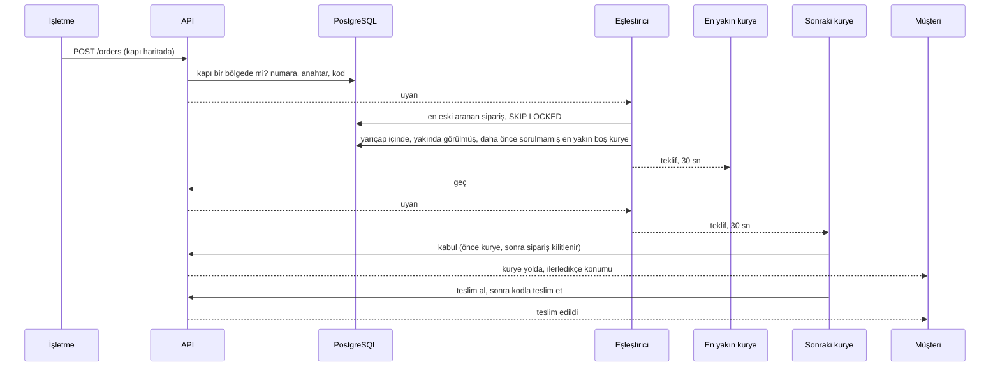

# Kuryo

[English](README.md) · **Türkçe**

Şehir içinde restoranlara, fırınlara ve eczanelere teslimat yapan kurye firmaları için sevkiyat sistemi. İşletme, müşterinin kapısını haritada işaretleyerek bir sipariş gönderir. Sipariş birkaç saniyeliğine en yakın boştaki kuryeye teklif edilir. Kurye geçerse ya da süre dolarsa teklif bir sonraki en yakın kuryeye gider; bu, biri alana kadar sürer. Kimse almazsa sipariş dispeçere düşer, dispeçer de elle atayabilir. Ofis her kuryeyi canlı bir haritada izler. Kuryeler telefondaki uygulamayla çalışır; uygulama kurye çevrim içiyken konumunu paylaşır. Müşteriler teslimatlarını hesap açmadan bir bağlantıdan takip eder ve kapıda kuryeye dört haneli bir kod verir.

[](https://github.com/Beratoguzhan620/kuryo/actions/workflows/ci.yml)




## Deneyin

```bash
docker compose up --build
```

Bu komut PostGIS'li PostgreSQL'i, Redis'i, API'nin iki örneğini ve web uygulamasıyla nginx'i başlatır. http://localhost:8080 adresini açın, bir hesap ve bir firma oluşturun. *Zones* altında haritada bir teslimat bölgesi çizin, ardından *Merchants* altında bir işletme ekleyin. *Team* altında ikinci bir hesabı kurye olarak ekleyin. Kurye olarak http://localhost:8080/courier adresinden, telefon boyutunda bir pencerede giriş yapın, konuma izin verin ve çevrim içi olun. Ofise dönüp *Live* ekranından bir sipariş gönderin. Teklif, geri sayımla birlikte kuryenin ekranında belirir.

- API dokümantasyonu: http://localhost:8080/scalar
- Takip bağlantıları http://localhost:8080/t/{token} biçimindedir; her siparişin sayfasında bağlantıyı kopyalayan bir düğme vardır.

## Özellikler

- **Firmalar ve ekipleri:** kuryeler teslimat yapar; işletme çalışanları kendi işletmelerinin siparişlerini gönderir ve izler; dispeçerler canlı haritayı yönetir, bölgeleri ve işletmeleri düzenler; sahipler ayrıca ekibi ve tekliflerin nasıl işleyeceğini yönetir. Üyelik ve rol her istekte veritabanından okunur. Bir üyenin göremeyeceği siparişler hiç yokmuş gibi yanıtlanır.
- **Teslimat bölgeleri:** haritada köşe köşe çizilen, PostGIS çokgenleri olarak saklanan ve her birinin kendi ücreti olan alanlar. Bir sipariş yalnızca kapı etkin bir bölgenin içindeyse alınır; bölgeler çakışırsa daha ucuz ücret geçerlidir.
- **İşletmeler:** bir alım noktası, bir telefon ve her tahminin beklediği olağan hazırlık süresi. Duraklatılmış bir işletme sipariş gönderemez.
- **Siparişler:** firma başına numaralanır (KR-001001); kapı haritada bir nokta, adres de kuryenin okuyacağı metindir. Her siparişin bir takip anahtarı ve bir teslim kodu vardır ve kimin ne yaptığının tam geçmişi tutulur.
- **Süreli teklifler:** her sipariş, firmanın yarıçapı içinde son iki dakikada görülmüş en yakın boştaki kuryeye belirli bir süre için teklif edilir. Geçen ya da yanıt vermeyen kuryeye o sipariş bir daha sorulmaz. Belirlenen sayıda tekliften sonra ya da arama o tekliflerin süreceği kadar uzadığında sipariş dispeçeri bekler.
- **Kontrol dispeçerde:** mesafeye göre seçilen bir kuryeye elle atama, siparişi geri alma, teklifleri yeniden gönderme, telefonla görüştükten sonra teslimatı kodsuz kapatma ya da iptal etme. Dispeçer işlem yaptığı anda açıkta kalan teklif geri çekilir.
- **Kurye uygulaması (PWA):** çevrim içi olma, konumu toplu gönderme, geri sayımlı teklifi görme, alma ya da geçme, siparişi teslim alma ve müşterinin koduyla bitirme. Beş yanlış kod, ofis kapatana kadar teslimatı kilitler.
- **Her yerde canlı:** siparişler ilerledikçe ve kuryeler hareket ettikçe ofis ekranları, işletmeler ve kurye telefonları SignalR ile güncellenir. Birden çok API örneği varsa mesajları aralarında Redis taşır.
- **Takip bağlantısı:** giriş gerekmez. Durumu, tahmini varış saatini, kuryenin adını ve yoldayken konumunu, kapıda verilecek kodu gösterir. Müşterinin adını, telefonunu ya da adresini asla göstermez ve teslimattan bir gün sonra sona erer.
- **Tahminler:** alım noktasına ve yolculuğa olan mesafe, şehir sokakları için 1,35 ile çarpılan kuş uçuşu mesafedir; hız bisikletle 14, scooter ile 24, arabayla 20 km/sa'tir. Kurye alım noktasından sipariş hazır olmadan çıkmaz.

## Ekran görüntüleri

| Canlı harita | Sipariş |
|---|---|
|  |  |
|  |  |

| Telefonda bir teklif | Teslimatta | Müşterinin bağlantısı |
|---|---|---|
|  |  |  |

## Ölçümler

`tests/load/load.mjs`, yoğun bir akşamı tam Compose yığınına (iki API örneği) karşı standart bir GitHub Actions makinesinde (4 çekirdek) çalıştırır; yük istemcisi de aynı makinededir. 300 kurye çevrim içi olur, şehirde dolaşır, iki saniyede bir konum bildirir ve teklif olup olmadığına bakar. Bir dakika içinde 200 sipariş gelir. Her simüle kurye tekliflerini yanıtlar (beşte biri geçer), siparişi alır ve kodla teslim eder.

| Adım | Sonuç |
|---|---|
| Toplam yük | 68 saniyede 21.371 istek, saniyede 314, hiç hata yok |
| Konum bildirimi (9.902) | p50 9 ms, p95 40 ms, p99 108 ms |
| Teklif kontrolü (9.502) | p50 4 ms, p95 15 ms |
| Yeni sipariş | p50 20 ms, p95 74 ms |
| Siparişten ilk teklife | p50 9 ms, p95 35 ms, en çok 380 ms |
| Siparişten kuryenin almasına | p50 1,3 sn, p95 3,3 sn (kuryeler 2 sn'de bir bakıyor) |
| Sipariş başına teklif | p50 1, en çok 4; 47 geçme |
| Sonuç | 200 siparişin 200'ü teslim edildi |
| Sonrasında kayıtlar | 247 teklif: 200 kabul, 47 ret, bekleyen yok; iki kez kabul edilen sipariş yok |

Rakamların anlattığı:

- İlk teklif milisaniyeler içinde gider, çünkü yeni sipariş eşleştiriciyi bir sonraki turunu beklemeden uyandırır; bekleyişin geri kalanı kuryenin teklifi okumasıdır.
- İki API örneği de eşleştiriciyi aynı anda çalıştırır. Siparişler ve kuryeler `FOR UPDATE SKIP LOCKED` ile alınır; böylece hiçbir örnek ötekini beklemez ve hiçbir sipariş iki kez teklif edilmez.
- Her örnek 150 MB'tan az bellek kullandı. Paylaşılan makinelerde sonuçlar çalıştırmadan çalıştırmaya değişir.

## Teknolojiler

- ASP.NET Core 10: minimal API'ler, SignalR, arka planda çalışan eşleştirici, ProblemDetails, Scalar ile OpenAPI, JWT bearer, istek sınırlama
- PostGIS'li PostgreSQL 17: coğrafi noktalar ve çokgenler, GiST indeksleri, en yakından sıralayan `<->`, `ST_DWithin`, `FOR UPDATE SKIP LOCKED`, kısmi benzersiz indeksler, advisory lock'lar, eşzamanlılık kontrolü için `xmin`; Npgsql ve NetTopologySuite ile Entity Framework Core 10
- SignalR arka katmanı olarak Redis
- React 18, TypeScript ve Vite; @microsoft/signalr; Geolocation API ve service worker; OpenStreetMap ile Leaflet; Lucide ikonları ve IBM Plex; nginx
- xUnit, Testcontainers (PostGIS), testlerde SignalR istemcisi, Vitest, konum taklidiyle Playwright
- GitHub Actions: uyarılar hata sayılır, .NET ve web testleri, bekleyen migration kontrolü, Compose yığınına karşı tarayıcı senaryosu
- Docker / Docker Compose

## Mimari



Bir sipariş, işletmeden kapıya:



## Tasarım kararları

- **Eşleştirme veritabanında, en yakından başlayarak.** Eşleştirici, kimsenin üzerinde çalışmadığı en eski siparişi seçer, ardından PostGIS'e şunu sorar: boşta olan, son iki dakikada görülmüş, yarıçap içinde bulunan, açık başka teklifi olmayan ve bu sipariş daha önce sorulmamış en yakın kurye kim? `<->` sıralamasını GiST indeksi yanıtlar; yüzlerce kurye arasından en yakını bulmak tek bir indeksli sorgudur.
- **Birden çok eşleştirici, çift teklif yok.** Siparişler ve kuryeler `FOR UPDATE SKIP LOCKED` ile alınır: bir örnek, başka bir örneğin uğraştığı satırı beklemek yerine atlar. İki kısmi benzersiz indeks (sipariş başına bir, kurye başına bir bekleyen teklif), kod hatalı olsa bile çift teklifi imkânsız kılar. Eşleştirici kilitleri aldıktan sonra yeniden kontrol eder; bu yüzden pratikte indekslerin "hayır" demesi gerekmez.
- **Süreye bir kez karar verilir.** Teklifin son anı teklif yapılırken belirlenir. Bu andan sonra kabul, eşleştirici teklifi süresi dolmuş olarak işaretlemeden önce bile başarısız olur; eşleştirici de süresi dolanları tek bir koşullu `UPDATE … RETURNING` ile kapatır. Bir yanıt ile süre dolması yarışırsa `xmin` kontrolü yalnızca birini geçirir.
- **Kilitler hep aynı sırada.** Bir kuryeye ve bir siparişe dokunan her yol önce kuryeyi, sonra siparişi, sonra teklifi kilitler. Böylece elle atama yapan bir dispeçer ile aynı anda kabul eden bir kurye kilitlenmeye (deadlock) yol açamaz.
- **Canlı güncellemeler kaydedilenden.** Bir kaydetme yakalayıcısı, her isteğin hangi siparişleri, kuryeleri ve teklifleri değiştirdiğini not eder. Yayıncı ancak istek başarıyla bittikten sonra bunların güncel halini yeniden okur ve doğru gruplara gönderir: ofis, işletme, kurye, müşterinin bağlantısı. Hiçbir istemci geri alınmış bir değişikliği görmez; her mesaj tam durumu taşıdığı için birleştirilecek bir şey de kalmaz.
- **Bağlandıktan sonra boşluk yok.** Bir ekran verisini yüklerken aynı anda canlı akışa katılır; katıldıktan sonra bir kez daha yükler. Böylece ikisi arasındaki bir değişiklik kaçmaz. Yeniden bağlanınca da aynısını yapar.
- **Konumlar toplu, bir de nabız.** Telefon en fazla üç saniyede bir nokta tutar ve beş saniyede bir toplu gönderir; çekmeyen bir yerden çıkınca en fazla elli nokta yollar. Telefon saatleri on dakika öncesi ile şimdi arasında tutulur ve daha eski bir nokta kuryeyi geri götürmez. Duran bir kurye, teklif almaya devam etsin diye son konumunu otuz saniyede bir yeniden gönderir.
- **Hiçbir şey ele vermeyen bağlantı.** Takip anahtarı 144 bitlik rastgele bir değerdir. Sayfa yalnızca müşterinin zaten bildiklerini gösterir, `no-store` ve `no-referrer` gönderir; istek günlüklerinde yol anahtarsız yazılır. Kurye teslim kodunu hiç görmez: kapıda sormak zorundadır.
- **Dürüstçe kuş uçuşu.** Mesafeler büyük daire üzerinden kilometredir; süreler 1,35 dolanma katsayısı ve araca göre ortalama hızla hesaplanır. Bir rota servisi bunu tek bir fonksiyonun arkasında değiştirebilir.
- **Sırayla çalışan örnekler.** Compose iki API örneği çalıştırır. Migration'ları bir PostgreSQL advisory lock'unun arkasında sırayla yaparlar, SignalR'ı Redis üzerinden paylaşırlar; nginx de her tarayıcıyı bağlantı kurduğu örnekte tutar.

## Komutlar

| Komut | Ne yapar |
|---|---|
| `docker compose up --build` | Tüm uygulama http://localhost:8080 adresinde |
| `dotnet test` | .NET birim ve entegrasyon testleri (Testcontainers için Docker gerekir) |
| `cd web && npm install && npm test` | Web uygulamasının birim testleri |
| `cd web && npm run dev` | 5800 portundaki API'ye bağlı, anında yenilenen web uygulaması: http://localhost:5173 |
| `cd tests/e2e && npm install && node kuryo.mjs` | Tarayıcı senaryosu; yığın `AUTH_ATTEMPTS_PER_MINUTE=1000` ile başlatılmış olmalı |
| `cd tests/e2e && node media.mjs` | Örnek bir firma ve README ekran görüntüleri |
| `node tests/load/load.mjs 300 200 60` | Yük testi; yığın `AUTH_ATTEMPTS_PER_MINUTE=100000` ile başlatılmış olmalı |
| `dotnet ef migrations add <Ad> --project src/Kuryo.Infrastructure --startup-project src/Kuryo.Api --output-dir Persistence/Migrations` | Migration ekler |

Yerel çalıştırma ayarları, depo dışında tutulur (Redis isteğe bağlıdır; olmadan canlı güncellemeler tek örnek içinde kalır):

```bash
dotnet user-secrets --project src/Kuryo.Api set "ConnectionStrings:Kuryo" "Host=localhost;Database=kuryo;Username=…;Password=…"
dotnet user-secrets --project src/Kuryo.Api set "ConnectionStrings:Redis" "localhost:6379"
dotnet user-secrets --project src/Kuryo.Api set "Jwt:SigningKey" "<en az 32 karakter>"
```

## Testler

112 test ve tüm yığına karşı bir çalıştırma: 56 .NET birim testi, gerçek API'yi Testcontainers'taki PostGIS'li PostgreSQL'e karşı çalıştıran 47 entegrasyon testi, web uygulaması için 9 Vitest testi ve beş tarayıcıyla 17 adımlık bir Playwright senaryosu; hepsi CI'da.

- **Ekipler ve yerler:** kuryeden sahibe roller, kendi işletmesine bağlı işletme çalışanları, sipariş taşıyan kuryenin ekipten çıkarılamaması, tekliflerin işleyişini yalnızca sahiplerin değiştirmesi, dışarıdakilerin bir firmanın varlığını anlayamaması ve çizilen, kenarları kesişince reddedilen, çakıştığında ucuz ücreti uygulanan bölgeler.
- **Siparişler:** aynı anda gelen on iki istekte boşluksuz numaralar, hiçbir bölgede olmayan adreslerin reddi, işletmelerin yalnızca kendi siparişlerini görmesi, aynı anda iki siparişe atanan kuryenin yalnızca birini alması, atama, geri verme, teslim alma, kodla teslim, sayılan ve beşte kilitlenen yanlış kodlar ve kuryeyi serbest bırakan iptaller.
- **Eşleştirme:** önce en yakın boş kuryeye sorulması, geçilen siparişin sonrakine gidip bir daha dönmemesi, süresi dolan tekliflerin ilerlemesi, süresi dolmuş teklifin kabul edilmemesi, aramanın belirlenen teklif sayısından ya da onların süreceği zamandan sonra bitmesi, çok uzaktaki ya da uzun süredir görülmeyen kuryelerin atlanması, elle atama, iptal ve çevrim dışı olmada teklifin geri çekilmesi ve aynı anda çalışan üç eşleştiricinin çift teklif vermemesi.
- **Konumlar:** yalnızca çevrim içiyken paylaşılması, istek başına en fazla elli nokta, telefon saatlerinin sınırlanması, daha eski bir noktanın kuryeyi geri götürmemesi ve bir siparişin izi.
- **Canlı:** dispeçerlerin siparişlerin ve kuryelerin hareketini duyması, kuryenin teklifinin gelişini ve gidişini duyması, işletmelerin yalnızca kendi siparişlerini duyması, dışarıdakilerin ve anahtarsız bağlantıların reddi, müşteri bilgisi olmayan takip bağlantısı, müşteri görünümünün kuryeyi izlemesi ve bağlantının teslimattan bir gün sonra sona ermesi.
- **Web uygulaması (Vitest):** konum kuyruğunun aralığı, sınırı ve yeniden denemesi, mesafeler, geri sayım, tazelik ve rotalar.
- **Tarayıcılar (CI):** bir sahibin bölge çizmesi, işletme ve ekip eklemesi; gerçek konumla çevrim içi olan iki kurye; haritadan sipariş gönderen bir kasiyer; en yakın kuryenin geçmesi ve sonrakinin alması; ofisin ve müşterinin canlı izlemesi; yanlış kodun reddi ve doğru kodla teslimatın kapanması; kimsenin yanıtlamadığı bir siparişin elle atanması ve hiç betik hatası olmaması.

## Yol haritası ve bilinen eksikler

- Kuş uçuşu yerine bir rota servisinden (OSRM, Valhalla) gerçek rotalar ve süreler.
- Toplu teslimat: aynı işletmeden iki siparişi bir kuryeye birlikte teklif etmek.
- Müşteriye bildirim (takip bağlantısı ve kodla SMS), [notification-service](https://github.com/Beratoguzhan620/notification-service) üzerinden.
- Firma başına kurye kazançları ve gün sonu raporları.
- Konumlar süresiz tutuluyor; bir temizlik işi birkaç hafta sonra bunları silebilir.
- Üyelik değişiklikleri açık canlı bağlantıyı kesmez; çıkarılan bir üye güncellemeleri bir sonraki yeniden bağlanmasında almayı bırakır.

## Lisans

[MIT](LICENSE) · Berat Oğuzhan Turğut · [GitHub](https://github.com/Beratoguzhan620)
